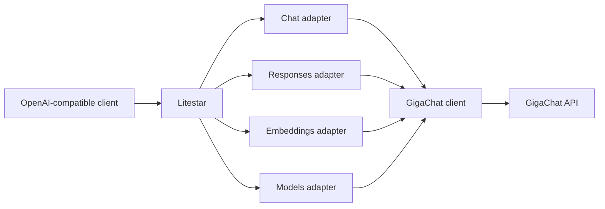

# Any2Giga design

**Status:** Draft. This document records agreed decisions and proposals that still need work. It
does not promise full OpenAI API compatibility.

## Idea

Any2Giga lets applications use GigaChat through familiar API formats. A client sends a request to
the gateway. The gateway translates it for GigaChat and returns the response in the client's format.

The first release targets applications and libraries that use an HTTP API. Tools such as Codex or
Claude Code can be useful compatibility checks, but passing those checks does not guarantee full
support for either tool.

The first supported format is OpenAI. We may add Anthropic and other formats later, when there is
demand and a clear contract.

## Principles

Preserve the meaning of requests and responses, and report unsupported features clearly.
Correctness, security and testability matter more than line count. See the
[architecture principles](../../../ARCHITECTURE.md) for development and testing rules.

## Decisions

### APIs and routes

The first release targets OpenAI Chat Completions, Responses and Embeddings, plus the models list.

| Any2Giga route | Purpose | GigaChat route |
| --- | --- | --- |
| `POST /v1/chat/completions` | OpenAI chat | `POST /v2/chat/completions` |
| `POST /v1/responses` | OpenAI Responses | `POST /v2/chat/completions` |
| `POST /v1/embeddings` | Text embeddings | `POST /v1/embeddings` |
| `GET /v1/models` | List available models | `GET /v1/models` |

The version in an Any2Giga URL identifies the client API, not the GigaChat API. Generation uses
only GigaChat v2. Embeddings and models use their official GigaChat v1 routes.

Sources: [GigaChat Chat Completions v2](https://developers.sber.ru/docs/ru/gigachat/api/reference/rest/post-chat-v-2),
[embeddings](https://developers.sber.ru/docs/ru/gigachat/guides/embeddings) and
[models](https://developers.sber.ru/docs/ru/gigachat/api/reference/rest/get-models).

These routes define the first release's scope. They do not imply support for every OpenAI parameter
or additional route.

### Account and stack

- One Any2Giga process uses one GigaChat account. The first release will not support multiple
  accounts in one process, account switching or client-supplied GigaChat credentials.
- Clients can request a model. Model names, aliases and a default model still need to be defined.
  Available features depend on the model and account.
- The stack is **Python, Litestar, the official GigaChat Python SDK, uv and pytest**.
- Chat Completions and Responses use separate adapters and a shared GigaChat client. Share
  translation code only where their behavior is the same.

## Architecture

The **HTTP layer** receives requests, validates their format and access, limits body size, and
returns errors and stream events in the format the client expects.

The **Chat and Responses adapters** translate messages, parameters, function calls, results and
stream events. Responses has its own input, output, function call and event formats; it cannot be
treated as a renamed Chat Completions API. See the
[OpenAI guide to Responses](https://developers.openai.com/api/docs/guides/migrate-to-responses).

The **GigaChat client** manages the SDK lifecycle, authentication, tokens, timeouts, concurrency
limits and retries. It does not contain rules for a specific client API.

The **Embeddings and Models adapters** call GigaChat and translate its responses. Embeddings come
from the selected GigaChat model. We must not present them as OpenAI model vectors or promise the
same dimensions.

## First release

For Chat Completions and Responses, the initial goal is text requests, regular and streamed
responses, function calls and function results. For Embeddings, the goal is text embeddings.
Each supported flow must work end to end, including errors and conversation continuation.

Function results must be linked to the calls that produced them. Parallel function calls depend on
the selected GigaChat model and need separate testing.

JSON output with a schema is a proposed feature. Support it only where the requested guarantees
can be verified for GigaChat. Do not claim strict schema compliance if the model or API cannot
provide it. Image, audio and document support remain open questions.

Token usage, finish reason and response status must reflect provider data. Do not invent precise
values when the provider does not supply them.

## Conversation history in Responses

The chosen direction for the first release is:

1. Clients can send the full conversation history in a request.
2. Use GigaChat v2 to store and continue conversations. Any2Giga is not expected to have its own
   persistent history store at launch.

This needs testing before we can claim support for `previous_response_id`. GigaChat uses a stored
conversation and `thread_id`; OpenAI Responses refers to a specific response. One ID cannot be
substituted for the other without proving that the behavior matches.

At minimum, check:

- Whether continuation uses the history up to the requested response, including when an older
  response is selected or multiple continuations run in parallel.
- How response IDs are made unique, and how a saved response is retrieved or deleted.
- What happens with `store: false`, including when `previous_response_id` is also set.
- Whether a conversation survives a gateway restart, how long GigaChat keeps it and what account
  limits apply.
- Whether instructions or the model can safely change when a conversation continues.

In OpenAI, `store` is enabled by default and controls whether a response is saved for later
retrieval through the API. GigaChat conversation storage alone does not prove support for all
these operations. Routes to retrieve and delete saved responses remain undecided. See
[OpenAI conversation state](https://developers.openai.com/api/docs/guides/conversation-state) and
the [GigaChat storage example](https://github.com/ai-forever/gigachat/blob/main/examples/chat_completions/thread_storage.py).

If the required behavior cannot be supported without gateway state, revisit the contract and
discuss the limitation or additional storage. Do not silently continue the wrong history or claim
that a response was saved without confirmation.

## Reliability and errors

### Concurrency

The generation limit covers one GigaChat account and all models used through it. Limits vary by
account type and settings. Embeddings and models may have different quotas; check them separately.
See [GigaChat limits](https://developers.sber.ru/docs/ru/gigachat/limitations).

Limit both the number of waiting requests and how long they can wait. A streaming request holds a
slot until the GigaChat request finishes or is cancelled. A client disconnect must release
resources.

A limit inside one process does not coordinate with other processes, gateway instances or
applications using the same account directly. Deployment and scaling rules remain open.

### 429 errors and retries

- Honor `Retry-After` when present, whether it contains seconds or an HTTP date.
- Limit the number of attempts and total waiting time. Use exponential backoff with jitter.
- Retry only when it is safe, such as after a request was explicitly rejected. Do not retry
  automatically when it is unclear whether the provider started processing or changed state.
- Do not retry a stream after sending response data to the client.
- Use one retry policy so the SDK and gateway do not multiply attempts.
- If a retry is unsafe or the time limit has expired, return a clear error and safe metadata
  that can help the client retry later.

### Streaming

Translate Chat Completions and Responses streams into events for the corresponding OpenAI API.
Where possible, detect a GigaChat error before sending HTTP headers to the client. Once the
response starts, the HTTP status cannot change. Report a later error in a way the client API
allows, or close the connection without signaling success.

Cancellation, errors and client disconnects must close the stream and release resources.

## Security and configuration

- Keep GigaChat credentials separate from client access to the gateway. Client authentication and
  launch settings are not decided yet.
- Enable TLS verification and allow a trusted certificate authority to be configured for GigaChat.
- Enforce the body size limit while reading data, including when `Content-Length` is absent.
- Keep secrets, requests and responses out of normal logs and client error messages. Limit and
  sanitize provider error details.
- Check the behavior of the selected SDK version. For example, the
  [SDK 0.2.3](https://github.com/ai-forever/gigachat/blob/v0.2.3/src/gigachat/api/utils.py)
  v2 SSE parser is built around named events and may log raw event data after a parse error.
  Verify the actual GigaChat stream format and the SDK version in use.

## Testing

The main test suite must run without a real account, using controlled GigaChat responses. Also
test the API through the official OpenAI SDK pointed at Any2Giga.

Cover:

- Text requests, client-supplied history, model selection and validation errors.
- Regular and streamed Chat Completions and Responses, including events and stream completion.
- A complete function call, with its result linked to the original call.
- Embeddings and model lists, result order and accurate usage data.
- `429`, `Retry-After`, a bounded queue, timeouts and no retries after streaming starts.
- Concurrent requests to one account, cancellation and resource cleanup.
- Body limits without `Content-Length`, sanitized errors and no sensitive data in logs.
- GigaChat storage: continuation, older IDs, parallel requests and gateway restarts.

Run live GigaChat integration tests separately and only with the required credentials. They must
confirm provider and SDK behavior.

## Open questions

1. Which inputs beyond text should the first release support: images, documents or audio?
2. Which parameters, function modes and structured output modes belong in each OpenAI API contract?
3. Which `store`, `previous_response_id`, response retrieval and deletion behaviors can GigaChat
   storage support without gateway state?
4. How are models selected and presented? Do we need aliases or a default model?
5. How do clients authenticate to Any2Giga? How is it started and deployed?
6. What are the default limits, queue sizes and timeouts? How do they work across processes?
7. Which Codex and other client scenarios should we test separately from the API contract?
